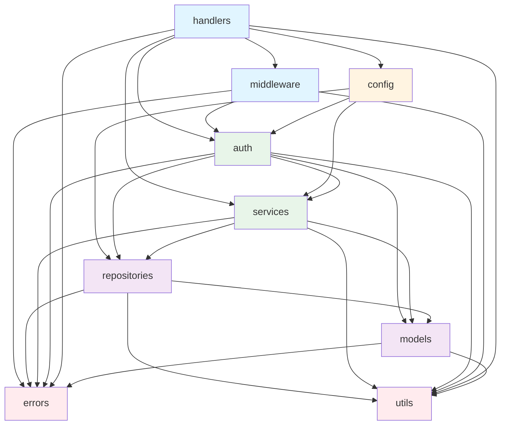

# Admin Server Architecture

## Overview

The admin server is a Rust-based web application built with Axum that provides user management, authentication, and access control functionality. The architecture follows a layered approach with clear separation of concerns and well-defined dependency directions.

## Architecture Principles

1. **Layered Architecture**: The application is organized into distinct layers, each with specific responsibilities
2. **Dependency Direction**: Dependencies flow downward - higher layers depend on lower layers, never upward
3. **No Circular Dependencies**: Modules are structured to prevent circular dependencies
4. **Single Responsibility**: Each module has a clear, focused purpose
5. **Separation of Concerns**: Business logic, data access, and presentation are clearly separated

## Module Hierarchy

The application is organized into 7 layers, from foundation to interface:

```
Layer 7: handlers/          (HTTP request handlers)
Layer 6: middleware/        (HTTP middleware - includes auth middleware)
Layer 5: config/            (Configuration and infrastructure)
Layer 4: services/          (Business logic - includes policy management)
         auth/              (Authentication core - service, models, extractors)
Layer 3: repositories/      (Data access layer)
Layer 2: models/            (Domain entities and DTOs)
Layer 1: errors/            (Error types)
         utils/             (Utility functions - includes templates and shutdown)
Layer 0: External crates    (Dependencies)
```

### Dependency Flow Diagram



## Layer Details

### Layer 1: Foundation

#### errors (src/errors/)

**Purpose**: Define application-wide error types and error handling

**Allowed Dependencies**: External crates only

**Forbidden Dependencies**: All internal modules

**Responsibility**:
- Define `AppError` enum with all error variants
- Implement error conversion from external error types
- Provide HTTP response formatting for errors
- Ensure consistent error handling across the application
- Provide specialized error types (AccessControlError)
- Provide error context utilities

**Submodules**:
- `mod.rs`: Core AppError and error handling
- `access_control.rs`: Access control specific errors
- `context.rs`: Error context and enrichment utilities

**Key Types**: `AppError`, `ErrorResponse`, `AccessControlError`, `ErrorSeverity`

**Refactoring Note**: Previously split between `src/errors.rs` and `src/errors/` directory. Consolidated into `src/errors/` directory for consistency.

#### utils (src/utils/)

**Purpose**: Provide reusable utility functions for common tasks

**Allowed Dependencies**: errors, external crates

**Forbidden Dependencies**: models, repositories, services, auth, config, middleware, handlers

**Responsibility**:
- Cookie creation and parsing
- HTTP header utilities
- Password hashing and verification
- Template setup and rendering
- JWT token generation and validation
- Sensitive data redaction in logs
- Graceful shutdown signal handling

**Submodules**: 
- `cookies`: Cookie creation and parsing
- `headers`: HTTP header utilities
- `password`: Password hashing and verification
- `templates`: Template engine setup and rendering
- `tokens`: JWT token generation and validation
- `log_redaction`: Sensitive data redaction
- `shutdown`: Graceful shutdown signal handling

**Refactoring Notes**: 
- Template setup functions moved from `config/template.rs` to consolidate all template-related code
- Shutdown utilities moved from `infrastructure/shutdown.rs` as they are general utilities

### Layer 2: Domain

#### models (src/models/)

**Purpose**: Define core data structures and domain entities

**Allowed Dependencies**: errors, utils, external crates

**Forbidden Dependencies**: repositories, services, auth, config, middleware, handlers

**Responsibility**:
- Define database entity structures
- Define API request/response DTOs
- Provide data validation rules
- Define domain-specific types and enums
- Implement serialization/deserialization

**Submodules**:
- `entities`: Database entity models (AdminUser, Permission, UserType, History, etc.)
- `dto`: Data Transfer Objects for API communication

**Key Types**: `AdminUser`, `Permission`, `UserType`, `CreateUserRequest`, `UpdateUserRequest`

### Layer 3: Data Access

#### repositories (src/repositories/)

**Purpose**: Abstract database operations and data persistence

**Allowed Dependencies**: models, errors, utils, external crates

**Forbidden Dependencies**: services, auth, config, middleware, handlers

**Responsibility**:
- Execute database queries (SELECT, INSERT, UPDATE, DELETE)
- Map database rows to domain entities
- Handle database transactions
- Provide data access abstractions
- Implement query optimization

**Design Principles**:
- Each repository handles one entity or aggregate
- Repositories should not contain business logic
- All database errors are converted to AppError
- Use prepared statements for SQL injection prevention

**Repositories**:
- `AccessEvaluationLogRepository`: Access decision logging
- `AuthRepository`: Authentication data access
- `HistoryRepository`: Audit trail data access
- `PermissionRepository`: Permission data access
- `PolicyRepository`: Access control policy data access
- `UserRepository`: User data access
- `UserTypeRepository`: User type data access

### Layer 4: Business Logic

#### services (src/services/)

**Purpose**: Implement business logic and orchestrate operations

**Allowed Dependencies**: repositories, models, errors, utils, external crates

**Forbidden Dependencies**: config (higher layer), middleware (higher layer), handlers (higher layer)

**Responsibility**:
- Implement business rules and validation
- Orchestrate operations across multiple repositories
- Handle complex workflows and transactions
- Provide service-level caching
- Implement access control and authorization logic
- Generate metrics and analytics
- Manage policy updates and listeners

**Design Principles**:
- Services should be stateless (except for injected dependencies)
- Each service handles one domain area or aggregate
- Services coordinate repositories but don't access database directly
- Business logic belongs in services, not repositories or handlers

**Services**:
- `access_control`: RBAC and ABAC authorization logic
  - `abac`: Attribute-Based Access Control
  - `rbac`: Role-Based Access Control
  - `cache`: Access control caching
  - `hybrid`: Hybrid access control combining RBAC and ABAC
  - `manager`: Access control manager
  - `resilience`: Circuit breakers and graceful degradation
- `access_evaluation_log`: Access decision logging service
- `history`: Audit trail and history tracking service
- `metrics`: Application metrics and monitoring
- `permission`: Permission management service
- `policy`: Policy update management (moved from config)
  - `update_manager`: Dynamic policy update management
  - `listeners`: Policy update listeners
- `user`: User management service
- `user_type`: User type/role management service

**Refactoring Note**: Policy management moved from `config/` to `services/policy/` as it contains business logic for managing policy updates and event broadcasting, not just configuration.

#### auth (src/auth/)

**Purpose**: Handle authentication core functionality

**Allowed Dependencies**: services, repositories, models, errors, utils, external crates

**Forbidden Dependencies**: config (higher layer), middleware (higher layer), handlers (higher layer)

**Responsibility**:
- User authentication (login, logout, session management)
- JWT token generation and validation
- User model definitions
- Request extractors for authenticated users

**Submodules**:
- `service`: Authentication service implementation
- `models`: User models and authentication types
- `extractor`: Axum extractors for authenticated users

**Key Types**: `AuthService`, `AuthnUser`, `User`, `UserId`

**Refactoring Note**: Authentication middleware moved to `middleware/auth.rs` for better organization. The auth module now focuses on core authentication logic, while middleware handles HTTP-level concerns.

### Layer 5: Configuration

#### config (src/config/)

**Purpose**: Application configuration and infrastructure management

**Allowed Dependencies**: services, auth, repositories, models, errors, utils, external crates

**Forbidden Dependencies**: middleware (higher layer), handlers (higher layer)

**Responsibility**:
- Load and validate environment configuration
- Initialize database connections and run migrations
- Manage service container with dependency injection
- Configure logging system
- Manage access control policies
- Provide security configuration (CORS, rate limiting, etc.)
- Define shared application state

**Design Principles**:
- Configuration should be loaded once at startup
- All configuration should be validated early
- Configuration errors should fail fast
- Infrastructure components initialized in dependency order

**Submodules**:
- `access_control`: Access control policy configuration
- `app_state`: Shared application state (moved from root)
- `container`: Service container with dependency injection (moved from infrastructure)
- `database`: Database connection setup and migrations (consolidated)
- `env_loader`: Environment variable loading and validation
- `logger`: Logging configuration and initialization (moved from infrastructure)
- `security`: Security configuration (CORS, rate limiting, etc.)

**Key Types**: `AppConfig`, `AccessControlConfigManager`, `ServiceContainer`, `AppState`

**Refactoring Notes**:
1. **Infrastructure module removed**: Components distributed to appropriate locations
   - `container.rs` → `config/container.rs` (configuration-related)
   - `logger.rs` → `config/logger.rs` (configuration-related)
   - `migrations.rs` → integrated into `config/database.rs` (related to database setup)
   - `shutdown.rs` → `utils/shutdown.rs` (general utility)
2. **AppState moved**: From `src/app_state.rs` to `config/app_state.rs` for better organization
3. **Policy management moved**: From `config/policy_*` to `services/policy/` (business logic)
4. **Template setup moved**: From `config/template.rs` to `utils/templates.rs` (utility function)

### Layer 6: Interface - Middleware

#### middleware (src/middleware/)

**Purpose**: HTTP middleware for cross-cutting concerns

**Allowed Dependencies**: auth, config, services, repositories, models, errors, utils, external crates

**Forbidden Dependencies**: handlers (higher layer)

**Responsibility**:
- Authentication and authorization checks
- Request/response logging
- Error handling and formatting
- Request timing and metrics
- CORS and security headers
- Rate limiting

**Design Principles**:
- Middleware should be composable and reusable
- Each middleware should have a single responsibility
- Middleware should not contain business logic
- Middleware should be order-independent where possible

**Middleware**:
- `auth`: Authentication middleware (auth, auth_user, optional_auth)
- `log`: Request/response logging middleware

**Refactoring Note**: Authentication middleware moved from `auth/middleware.rs` to `middleware/auth.rs`. This provides better separation of concerns - the auth module focuses on core authentication logic (service, models, extractors), while the middleware module handles all HTTP-level cross-cutting concerns including authentication checks.

### Layer 7: Interface - Handlers

#### handlers (src/handlers/)

**Purpose**: HTTP request handlers and routing

**Allowed Dependencies**: All lower layers

**Forbidden Dependencies**: None (this is the top layer)

**Responsibility**:
- Parse and validate HTTP requests
- Extract request parameters and body
- Call appropriate services to handle business logic
- Format responses (JSON for API, HTML for views)
- Handle HTTP-specific concerns (status codes, headers)
- Apply authentication and authorization checks

**Design Principles**:
- Handlers should be thin - delegate to services for business logic
- Each handler should handle one endpoint or related group of endpoints
- Handlers should not contain business logic
- Handlers should validate input and format output only
- Use DTOs for request/response serialization

**Submodules**:
- `api`: REST API endpoints (JSON responses)
  - `access_control`: Access control management endpoints
  - `auth`: Authentication endpoints (login, logout, register)
  - `dashboard`: Dashboard data endpoints
  - `permission`: Permission management endpoints
  - `user`: User management endpoints
  - `user_type`: User type management endpoints
- `views`: HTML template rendering endpoints

## Dependency Rules

### Allowed Dependencies by Layer

| Layer | Module | Can Depend On |
|-------|--------|---------------|
| 7 | handlers | All layers below |
| 6 | middleware | auth, config, services, repositories, models, errors, utils |
| 5 | config | services, auth, repositories, models, errors, utils |
| 4 | services, auth | repositories, models, errors, utils |
| 3 | repositories | models, errors, utils |
| 2 | models | errors, utils |
| 1 | errors, utils | External crates only |

### Forbidden Dependencies

These dependencies are explicitly forbidden to maintain architectural integrity:

1. **Upward Dependencies**: Lower layers cannot depend on higher layers
   - ❌ models → services
   - ❌ repositories → services
   - ❌ services → config
   - ❌ auth → config
   - ❌ config → handlers
   - ❌ middleware → handlers

2. **Cross-Layer Dependencies**: Modules at the same layer should minimize dependencies
   - ⚠️ auth ↔ services (allowed but should be minimized)

3. **Foundation Dependencies**: Foundation modules cannot depend on any internal modules
   - ❌ errors → any internal module
   - ❌ utils → models, repositories, services, etc.

### Breaking Circular Dependencies

The architecture has been refactored to eliminate circular dependencies and improve module organization:

1. **Errors Module Consolidation**: 
   - Consolidated `src/errors.rs` into `src/errors/mod.rs`
   - All error-related code now in `src/errors/` directory
   - Eliminates confusion between file and directory structure

2. **AppState Relocation**: 
   - Moved from `src/app_state.rs` to `src/config/app_state.rs`
   - Better organization - AppState is configuration-related
   - Re-exported from lib.rs for backward compatibility

3. **Infrastructure Module Removal**: 
   - Distributed components to more appropriate locations:
     - `container.rs` → `config/container.rs` (configuration component)
     - `logger.rs` → `config/logger.rs` (configuration component)
     - `migrations.rs` → integrated into `config/database.rs` (related to DB setup)
     - `shutdown.rs` → `utils/shutdown.rs` (general utility)
   - Eliminates overly abstract "infrastructure" concept
   - Each component now in a location that reflects its actual purpose

4. **Middleware Consolidation**: 
   - Moved authentication middleware from `auth/middleware.rs` to `middleware/auth.rs`
   - All HTTP middleware now in `middleware/` module
   - Auth module focuses on core authentication logic (service, models, extractors)
   - Better separation of concerns between business logic and HTTP concerns

5. **Template Consolidation**: 
   - Moved template setup from `config/template.rs` to `utils/templates.rs`
   - All template-related code now in one place
   - Templates are utilities, not configuration

6. **Policy Management Relocation**: 
   - Moved from `config/policy_update_manager.rs` and `config/policy_listeners.rs`
   - To `services/policy/update_manager.rs` and `services/policy/listeners.rs`
   - Policy management is business logic, not configuration
   - Better reflects the actual responsibility (event broadcasting, listener management)

7. **Template Utilities**: 
   - Refactored to accept `&Tera` instead of `&AppState`
   - Breaks utils → app_state dependency
   - Makes utilities more reusable and testable

## Module Communication Patterns

### Request Flow

A typical HTTP request flows through the layers as follows:

```
1. HTTP Request
   ↓
2. handlers (Layer 7)
   - Parse request
   - Extract parameters
   ↓
3. middleware (Layer 6)
   - Authentication check (via auth module)
   - Logging
   ↓
4. services (Layer 4)
   - Business logic
   - Validation
   ↓
5. repositories (Layer 3)
   - Database queries
   ↓
6. Database
   ↓
7. Response flows back up through layers
```

### Service Initialization Flow

Application startup follows this initialization order:

```
1. Load environment configuration (config/env_loader)
   ↓
2. Initialize logger (config/logger)
   ↓
3. Connect to database (config/database)
   ↓
4. Run migrations (config/database)
   ↓
5. Initialize repositories
   ↓
6. Initialize services
   ↓
7. Initialize auth service
   ↓
8. Create service container (config/container)
   ↓
9. Initialize access control (config/access_control)
   ↓
10. Initialize policy listeners (services/policy)
   ↓
11. Setup template engine (utils/templates)
   ↓
12. Create AppState (config/app_state)
   ↓
13. Set up middleware (middleware/auth, middleware/log)
   ↓
14. Register handlers
   ↓
15. Start HTTP server (with utils/shutdown for graceful shutdown)
```

## Design Patterns

### Repository Pattern

All data access is abstracted through repository interfaces:

```rust
pub struct UserRepository {
    pool: SqlitePool,
}

impl UserRepository {
    pub async fn find_by_id(&self, id: i64) -> Result<Option<AdminUser>, AppError> {
        // Database query implementation
    }
}
```

### Service Layer Pattern

Business logic is encapsulated in service classes:

```rust
pub struct UserService {
    user_repo: UserRepository,
    history_repo: HistoryRepository,
}

impl UserService {
    pub async fn create_user(&self, request: CreateUserRequest) -> Result<AdminUser, AppError> {
        // Business logic: validation, password hashing, etc.
        // Calls repositories for data access
    }
}
```

### Dependency Injection

Services are initialized with their dependencies and stored in a service container:

```rust
pub struct ServiceContainer {
    pub user_service: UserService,
    pub permission_service: PermissionService,
    // ... other services
}
```

### Middleware Pattern

Cross-cutting concerns are implemented as Axum middleware:

```rust
pub async fn log(
    req: Request,
    next: Next,
) -> Response {
    // Log request
    let response = next.run(req).await;
    // Log response
    response
}
```

## Security Architecture

### Authentication Flow

1. User submits credentials to `/api/auth/login`
2. `AuthService` validates credentials against database
3. JWT token is generated and returned
4. Client includes token in `Authorization` header for subsequent requests
5. `auth` middleware validates token and extracts user information
6. Handlers receive authenticated user via `AuthnUser` extractor

### Authorization Flow

1. Handler receives authenticated user
2. Handler calls access control service with user context and resource
3. Access control service evaluates RBAC and/or ABAC policies
4. Decision is logged to access evaluation log
5. Handler proceeds or returns 403 Forbidden

### Access Control

The application supports multiple access control models:

- **RBAC (Role-Based Access Control)**: Users have roles, roles have permissions
- **ABAC (Attribute-Based Access Control)**: Policies evaluate user and resource attributes
- **Hybrid**: Combines RBAC and ABAC for flexible authorization

## Performance Considerations

### Caching Strategy

- **Access Control Cache**: Caches permission checks to reduce database queries
- **Policy Cache**: Caches ABAC policies to avoid repeated parsing
- **Cache Invalidation**: Automatic invalidation on policy updates

### Database Optimization

- **Connection Pooling**: SQLx connection pool for efficient database access
- **Prepared Statements**: All queries use prepared statements
- **Indexes**: Database indexes on frequently queried columns
- **Query Optimization**: Optimized queries to minimize N+1 problems

### Async/Await

- All I/O operations are async for better concurrency
- Tokio runtime for efficient async task scheduling

## Testing Strategy

### Unit Tests

- Test individual functions and methods in isolation
- Mock dependencies using traits
- Focus on business logic in services

### Integration Tests

- Test complete request/response flows
- Use test database for data access tests
- Test authentication and authorization flows

### Test Organization

```
tests/
├── auth_api_test.rs          # Authentication API tests
├── integration_test.rs       # Full integration tests
└── query_optimization_test.rs # Database query tests
```

## Error Handling

### Error Propagation

Errors flow upward through layers:

1. Database errors → `AppError::DatabaseError`
2. Service errors → `AppError` variants
3. Handler errors → HTTP responses with appropriate status codes

### Error Response Format

All API errors return consistent JSON format:

```json
{
  "error": "ERROR_CODE",
  "message": "Human-readable error message",
  "status_code": 400,
  "timestamp": "2025-11-11T10:00:00Z",
  "path": "/api/users/123"
}
```

## Monitoring and Observability

### Logging

- Structured logging with tracing crate
- Log levels: ERROR, WARN, INFO, DEBUG, TRACE
- Sensitive data redaction in logs
- Request/response logging via middleware

### Metrics

- Access control evaluation metrics
- Request timing and throughput
- Error rates and types
- Database query performance

### Audit Trail

- All user actions logged to history table
- Access control decisions logged to access_evaluation_log table
- Immutable audit trail for compliance

## Future Architecture Improvements

### Potential Enhancements

1. **Event-Driven Architecture**: Introduce event bus for decoupled communication
2. **CQRS**: Separate read and write models for better scalability
3. **Microservices**: Split into smaller services if needed
4. **GraphQL**: Add GraphQL API alongside REST
5. **Workspace Split**: Split into multiple Rust crates for better compilation times

### Scalability Considerations

1. **Horizontal Scaling**: Stateless design allows multiple instances
2. **Database Sharding**: Partition data for larger datasets
3. **Caching Layer**: Add Redis for distributed caching
4. **Message Queue**: Add message queue for async processing

## Recent Refactoring (Project Structure Refinement)

### Overview

A comprehensive refactoring was completed to improve module organization and eliminate structural inconsistencies. The refactoring focused on moving components to more intuitive locations and consolidating related functionality.

### Changes Made

#### 1. Errors Module Consolidation

**Before**: Error code split between `src/errors.rs` and `src/errors/` directory
**After**: All error code in `src/errors/` directory

**Rationale**: Having both a file and directory with the same name was confusing. Consolidating into a directory structure provides room for growth and better organization.

**Impact**: No import path changes required - fully backward compatible.

#### 2. AppState Relocation

**Before**: `src/app_state.rs` (standalone file in root)
**After**: `src/config/app_state.rs`

**Rationale**: AppState is fundamentally a configuration component that aggregates all application configuration and shared resources. It belongs in the config module rather than the src root.

**Impact**: Import paths updated throughout codebase. Re-exported from lib.rs for backward compatibility.

#### 3. Infrastructure Module Removal

**Before**: Abstract `infrastructure/` module containing disparate components
**After**: Components distributed to appropriate locations

| Component | Old Location | New Location | Rationale |
|-----------|-------------|--------------|-----------|
| ServiceContainer | infrastructure/container.rs | config/container.rs | Configuration component for DI |
| Logger setup | infrastructure/logger.rs | config/logger.rs | Configuration component |
| Migrations | infrastructure/migrations.rs | config/database.rs | Related to database setup |
| Shutdown | infrastructure/shutdown.rs | utils/shutdown.rs | General utility function |

**Rationale**: The "infrastructure" name was too abstract and didn't reflect the actual purpose of the components. Each component has been moved to a location that better reflects its responsibility:
- Configuration-related components → `config/`
- General utilities → `utils/`
- Database-related functionality consolidated in `database.rs`

**Impact**: Import paths updated throughout codebase. Clearer module organization.

#### 4. Middleware Consolidation

**Before**: Authentication middleware in `auth/middleware.rs`, logging middleware in `middleware/log.rs`
**After**: All middleware in `middleware/` module

| Middleware | Old Location | New Location |
|------------|-------------|--------------|
| auth, auth_user, optional_auth | auth/middleware.rs | middleware/auth.rs |
| log | middleware/log.rs | middleware/log.rs (unchanged) |

**Rationale**: 
- Middleware is an HTTP-level concern, not a business logic concern
- All middleware should be in one place for consistency
- Auth module can focus on core authentication logic (service, models, extractors)
- Better separation between business logic (auth service) and HTTP concerns (auth middleware)

**Impact**: Import paths updated in all handlers. Clearer separation of concerns.

#### 5. Template Consolidation

**Before**: Template setup in `config/template.rs`, rendering in `utils/templates.rs`
**After**: All template functionality in `utils/templates.rs`

**Rationale**: 
- Template setup is a utility function, not configuration
- Having template code split between config and utils was confusing
- Consolidating in utils provides a single location for all template-related code

**Impact**: Import paths updated. Simpler mental model for template usage.

#### 6. Policy Management Relocation

**Before**: Policy management in `config/policy_update_manager.rs` and `config/policy_listeners.rs`
**After**: Policy management in `services/policy/` module

| Component | Old Location | New Location |
|-----------|-------------|--------------|
| PolicyUpdateManager | config/policy_update_manager.rs | services/policy/update_manager.rs |
| Policy listeners | config/policy_listeners.rs | services/policy/listeners.rs |

**Rationale**: 
- Policy update management is business logic, not configuration
- Involves event broadcasting, listener management, and state coordination
- Services layer is the appropriate place for business logic
- Config should focus on loading and validating configuration, not managing runtime behavior

**Impact**: Import paths updated. Better reflects the actual responsibility of policy management.

#### 7. Empty Directory Cleanup

**Before**: Empty `src/config/auth/` directory
**After**: Directory removed

**Rationale**: Empty directories add clutter and confusion. Clean project structure.

### Benefits Achieved

1. **Improved Discoverability**: Components are now in locations that match their actual purpose
2. **Better Separation of Concerns**: Clear distinction between configuration, business logic, utilities, and HTTP concerns
3. **Reduced Confusion**: Eliminated ambiguous module names like "infrastructure"
4. **Consolidated Functionality**: Related code is now grouped together (errors, templates, middleware)
5. **Cleaner Structure**: No empty directories or split functionality
6. **Maintained Compatibility**: Re-exports ensure existing code continues to work

### Migration Impact

All changes were made incrementally with full test coverage maintained throughout. The refactoring:
- ✅ Maintains all existing functionality
- ✅ Passes all existing tests
- ✅ Improves code organization without changing behavior
- ✅ Provides clearer module boundaries
- ✅ Makes the codebase easier to navigate for new developers

## Conclusion

This architecture provides a solid foundation for a maintainable, scalable admin server. The layered approach with clear dependency rules ensures that the codebase remains organized and easy to understand as it grows. The separation of concerns allows different parts of the system to evolve independently while maintaining overall system integrity.

The recent refactoring has further improved the architecture by ensuring that each component is in a location that accurately reflects its purpose and responsibility. This makes the codebase more intuitive and easier to maintain.

## References

- [Axum Documentation](https://docs.rs/axum/)
- [SQLx Documentation](https://docs.rs/sqlx/)
- [Tokio Documentation](https://tokio.rs/)
- [Clean Architecture](https://blog.cleancoder.com/uncle-bob/2012/08/13/the-clean-architecture.html)
- [Repository Pattern](https://martinfowler.com/eaaCatalog/repository.html)
